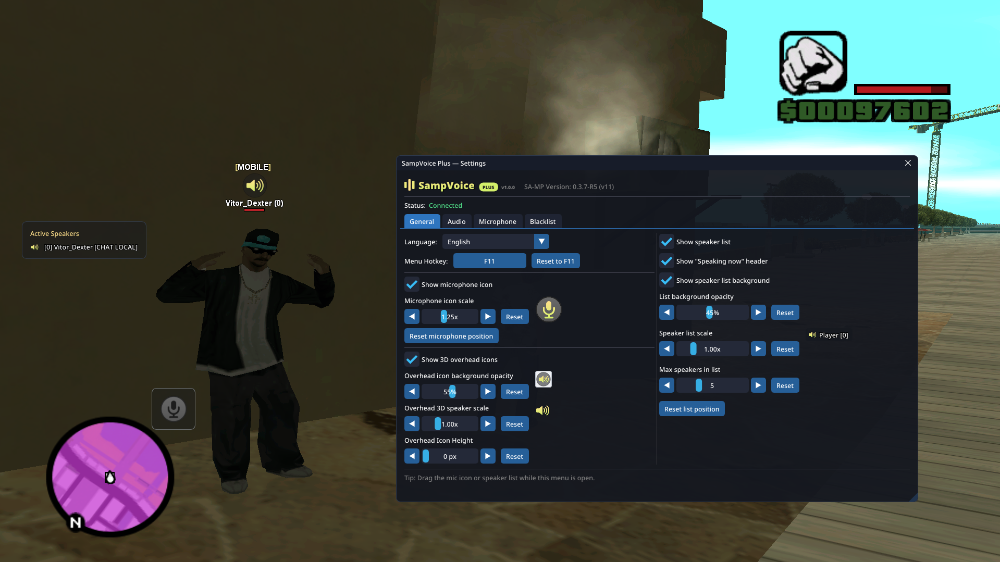

# SampVoice Plus

[](https://github.com/Walter-Correa/SampVoice-Plus/releases)
[](https://opensource.org/licenses/MPL-2.0)
[-orange.svg)](https://open.mp)

**SampVoice Plus** is a ground-up **C++20** re-architecture of the SampVoice voice chat ecosystem engineered for high-throughput **San Andreas Multiplayer (SA-MP)** and **open.mp** 32-bit x86 servers alongside a **single-file standalone Windows client (`sampvoice.asi`)** and an optional **15-language Windows installer (`SampVoice-Plus-Setup.exe`)**.

It empowers server owners and Pawn developers to deploy real-time **Global Channels**, **3D Proximity Spatial Voice**, **Vehicle & Player-Attached Megaphones**, **Per-Stream Custom HUD Icons**, **Per-Player Global Listener Control**, **Smooth Parameter Sliding**, and **9 DX8 DSP Audio Effects**—with non-blocking UDP I/O, lock-free queues, $O(1)$ spatial grid indexing, opaque 32-bit generational handles, universal **0.3.7-R1 through 0.3.DL-R1 / open.mp** client support in a single `.asi` file, and full backward compatibility with legacy `CyberMor` v3.x and `AmyrAhmady` (`v11`) clients and servers.

> [!NOTE]
> Inspired by the original [sampvoice](https://github.com/CyberMor/sampvoice) by [@CyberMor](https://github.com/CyberMor) and its open.mp adaptation by [@AmyrAhmady](https://github.com/AmyrAhmady), **SampVoice Plus** is rebuilt from the ground up in C++20 to leave `samp.dll` machine code completely unpatched, eliminate external `bass_fx.dll` and loose asset packs, isolate audio/capture/UDP processing onto a dedicated audio thread, and harden both client and server stability.

---

<p align="center">
  
</p>

---

## Comparison: SampVoice Implementations

| Feature | CyberMor 3.x | CyberMor 4.x | AmyrAhmady | SampVoice Plus |
| :--- | :--- | :--- | :--- | :--- |
| CyberMor 4.x clients | ❌ v11 only¹ | ✅ v4 only¹ | ❌ v11 only¹ | ❌ v11 and v12¹ |
| Legacy v11 clients | ✅ Same protocol | ❌ Incompatible | ✅ Same protocol | ✅ Simultaneous¹ |
| Server platforms | ⚠️ 0.3.7-R2 only | ⚠️ R2 and voice² | ⚠️ open.mp only | ✅ open.mp, R2/R3, DL |
| PC client versions | ⚠️ R1, R3 only | ⚠️ R1, R3 only | ⚠️ R1, R3 only | ✅ R1–R5, DL, omp³ |
| Voice relay architecture | Integrated | Separate process⁴ | Integrated | Integrated |
| Client deployment | ⚠️ Extra DLL + files⁵ | ⚠️ Extra DLL + files⁵ | ⚠️ Manual DLL + files⁵ | ✅ Single file⁵ |
| Backup & restore setup | ❌ Overwrites files | ❌ Overwrites files | ❌ No installer | ✅ SHA-256 backup⁶ |
| Unpatched client & AC | ❌ Patches samp.dll | ❌ Patches samp.dll | ❌ Patches samp.dll | ✅ Zero patches⁷ |
| Pawn.RakNet coexistence | ❌ Permanent hook⁸ | ⚠️ Permanent hook⁸ | N/A (component) | ✅ One-shot hook⁸ |
| Fixed port & bind IP | ❌ Ephemeral port⁹ | ✅ Port and host⁹ | ⚠️ Fixed port only⁹ | ✅ Port and bind IP⁹ |
| UDP flood protection | ❌ None | ❌ None | ❌ None | ✅ Token bucket¹⁰ |
| GMX & filterscript safety | ❌ Raw pointers | ⚠️ Pool IDs only¹¹ | ❌ Raw pointers | ✅ HandlePool cleanup¹¹ |
| YSI y_hooks support | ❌ Broken¹² | ⚠️ Tag issue¹² | ⚠️ Tag issue¹² | ✅ Compatible¹² |
| Stream icons | ❌ Fixed icon | ✅ Custom PNGs¹³ | ❌ Fixed icon | ✅ 7 built-in¹³ |
| Listener & speaker control | ⚠️ Mic mute only¹⁴ | ✅ Full control¹⁴ | ⚠️ Mic mute only¹⁴ | ✅ Full control¹⁴ |
| Interior, VW & spectate | ❌ Distance only | ❌ Distance only | ⚠️ No spectate¹⁵ | ✅ Full filtering¹⁵ |
| Stuck speaker guard | ❌ Stale entries¹⁶ | ✅ Clears on stop¹⁶ | ❌ Inherited¹⁶ | ✅ 400 ms timeout¹⁶ |
| PlayAudioStream stereo | ❌ Mutates globals¹⁷ | ❌ Mutates globals¹⁷ | ❌ Mutates globals¹⁷ | ✅ Preserves BASS¹⁷ |
| In-game menu languages | 1 (Russian) | 5 languages¹⁸ | 1 (Russian) | ✅ 15 built-in¹⁸ |
| DX8 audio effects | ✅ 9 filters | ✅ 9 filters | ✅ 9 filters | ✅ 9 filters¹⁹ |
| Diagnostics & talk modes | ❌ PTT only | ⚠️ Lang, PTT only | ❌ PTT only | ✅ Full suite²⁰ |
| Jitter, FEC & PLC | ⚠️ FEC only²¹ | ⚠️ Ring + PLC²¹ | ⚠️ FEC only²¹ | ✅ 35 ms + FEC/PLC²¹ |
| License | MIT | MIT | MIT | MPL-2.0 |

#### Notes

1. **Protocol & 4.x compatibility:** CyberMor 4.x clients send the `0xDEADC0DE` magic (`v4` only) and are incompatible with `v11`; SampVoice Plus servers accept both `v11` (CyberMor 3.x, AmyrAhmady, Android launchers) and `v12` (`SVP1` extension) simultaneously while rejecting `v4` (`0xDEADC0DE`).
2. **Server targets:** SampVoice Plus ships both an open.mp native component and a SA-MP plugin for `0.3.7-R2`, `0.3.7-R3`, and `0.3.DL-R1` (32-bit Windows & Linux).
3. **PC client coverage:** Strictly matches PE `TimeDateStamp` + `AddressOfEntryPoint` across `0.3.7-R1`, `R2`, `R3`/`R3-1`, `R4`, `R4-2`, `R5-1` (`R5-2-MP`), `0.3.DL-R1` (`DL-R1-2-MP`), and the open.mp launcher in a single `.asi`.
4. **External relay process:** CyberMor 4.x requires running a separate `voice` process alongside the SA-MP server; the other implementations integrate the UDP voice relay inside the plugin/component.
5. **Client dependencies:** CyberMor 3.x/4.x and AmyrAhmady require external `bass_fx.dll` and loose font/asset files; SampVoice Plus bundles everything into a single `sampvoice.asi` and a single server binary (`sampvoice.dll` / `.so`).
6. **Installer:** Guided 15-language Inno Setup installer with SHA-256 backup and restore manifest.
7. **Anti-cheat safety:** Leaves `samp.dll` machine code completely unpatched (`Present`/`Reset` Direct3D 9 hooks only).
8. **`Pawn.RakNet` / `YSF` coexistence:** Upstream 3.x keeps a permanent `GetRakServerInterface` hook (#43, #54, #71, #72, #117, #118, #133, #171); CyberMor 4.x also keeps a permanent hook (with no conflict reports found); open.mp components do not use that hook; SampVoice Plus removes its one-shot hook immediately after binding.
9. **Network configuration:** CyberMor 3.x uses an ephemeral OS port on `INADDR_ANY` (`sv_voice_port` was added to source in 2022, never released in 3.x); CyberMor 4.x supports `voice_port` & `voice_host`; AmyrAhmady exposes `sampvoice.port` without bind IP; SampVoice Plus configures both `sampvoice.port` and `sampvoice.bind` (failing loudly on invalid bind/port).
10. **Flood defense:** Per-player UDP token bucket (30 pkt/s sustained, burst 10).
11. **Lifecycle safety:** Legacy 3.x and AmyrAhmady use raw pointers that leak on GMX; CyberMor 4.x uses pool IDs without per-AMX tracking; SampVoice Plus pairs 32-bit generational `HandlePool` handles with automatic per-AMX unload cleanup.
12. **`y_hooks` interoperability:** Legacy 3.x caches `AmxLoad` indices only and `SV_VOID: void:` breaks `y_hooks`; CyberMor 4.x removes key callbacks cleanly but keeps `SV_VOID: void:` in `sampvoice.inc`; AmyrAhmady uses runtime `amx_FindPublic` but retains `void:`-tagged forwards; SampVoice Plus uses empty `SV_VOID:` + runtime `amx_FindPublic`.
13. **Stream icons:** `SvSetIcon` in CyberMor 4.x accepts custom PNGs; `SvStreamSetIcon` in SampVoice Plus (`v12`) selects from 7 built-in SVG/PNG icons (`speaker`, `global`, `radio`, `phone`, `megaphone`, `admin`, `police`).
14. **Mute & listener controls:** 3.x and AmyrAhmady only provide mic muting (`SvMutePlayer*`); CyberMor 4.x provides `SvEnableListener` + `SvEnableSpeaker`; SampVoice Plus provides `SvEnableListener`/`Disable`/`Check` + `SvMutePlayer*`.
15. **World filtering:** CyberMor 3.x and 4.x check streamed-in & distance only; AmyrAhmady checks interior & virtual world without spectate tracking; SampVoice Plus filters interior, virtual world, and active spectate target.
16. **Stuck speaker name (#44):** Legacy 3.x/AmyrAhmady have known stale entries; CyberMor 4.x clears via `OnStopStream` on stop/release; SampVoice Plus enforces a 400 ms per-channel timeout plus disconnect detach.
17. **`PlayAudioStream` stereo (#136):** Legacy 3.x and AmyrAhmady alter global `GVOL_STREAM`, `BUFFER`, and `UPDATEPERIOD` (and 4.x also alters `UPDATETHREADS`, `DEV_PERIOD`/`DEV_BUFFER`, and `BASS_DEVICE_MONO`); SampVoice Plus leaves `BASS_Init` and `GVOL_STREAM` untouched.
18. **UI translations:** CyberMor 3.x and AmyrAhmady are Russian-only; CyberMor 4.x supports 5 languages (`en` + 4 `.txt` files); SampVoice Plus includes **15 built-in languages** with real-time switching.
19. **DSP effects:** All 9 DX8 audio filters via `SvEffectCreate*`.
20. **Client UX:** Configurable menu hotkey (no longer fixed to `F11`), 9-state F11 diagnostics + RTT, 2s microphone hot-plug detection, and both Push-to-Talk and Toggle talk modes.
21. **Recovery pipeline:** 3.x/AmyrAhmady decode FEC only and drop late frames; CyberMor 4.x has a ring buffer + FEC + PLC (with encoder FEC off); SampVoice Plus combines a 35 ms `SpeakerJitterBuffer`, Opus in-band FEC, 4800-sample PLC, and an adaptive `1..4`-frame prebuffer cushion.

### When Another Option May Fit
* Choose **CyberMor 4.x** if your community already deploys `CyberMor 4.x` client installers (`0xDEADC0DE`) or specifically requires splitting the voice relay into a separate external `voice` process.
* Choose **AmyrAhmady** if you only target open.mp with vanilla `0.3.7-R1`/`R3` clients and prefer a minimal MIT-licensed fork matching upstream 3.x.
* Choose **SampVoice Plus** if you want universal `0.3.7-R1`–`0.3.DL-R1` / open.mp support in a single drop-in `sampvoice.asi`, compatibility with existing `v11` PC and Android clients, unpatched `samp.dll`, fixed port/IP control, and 15-language UI.

---

## Supported Platforms

| Category | Supported Targets & Notes |
| :--- | :--- |
| **Server Binaries** | open.mp native component, SA-MP 0.3.7-R2 (R2-1, R2-2-1) & 0.3.7-R3 (Win/Linux x86), SA-MP 0.3.DL-R1 (Win/Linux x86). |
| **PC Clients** | SA-MP 0.3.7-R1, R2, R3/R3-1, R4, R4-2, R5-1 (R5-2-MP), 0.3.DL-R1 (DL-R1-2-MP), and open.mp launcher (strict PE timestamp + entry match). |
| **Operating Systems** | **Client:** Windows 7 SP1 or newer (Win32 x86 game). **Server:** Windows x86 or 32-bit x86 Linux (glibc 2.31+). |
| **Android Launchers** | ✅ Android launchers embedding SampVoice 3.x (`v11`) work with SampVoice Plus servers. *(No SampVoice Plus Android client exists.)* |
| **Legacy Compatibility** | CyberMor 3.x and AmyrAhmady (`v11`) clients interoperate seamlessly. **CyberMor 4.x clients cannot connect** and must use SampVoice Plus. |
| **Languages (15)** | Indonesian (`id`), German (`de`), English (`en`), Spanish (`es`), French (`fr`), Italian (`it`), Hungarian (`hu`), Polish (`pl`), Portuguese (`pt`), Romanian (`ro`), Vietnamese (`vi`), Turkish (`tr`), Bulgarian (`bg`), Russian (`ru`), Ukrainian (`uk`). |

---

## Documentation Hub

| Guide | Description |
| :--- | :--- |
| **[📖 Getting Started](docs/getting-started.md)** | Client (`SampVoice-Plus-Setup.exe` & manual `sampvoice.asi`) + server setup, configuration, and drop-in migration. |
| **[🎧 Universal Client & In-Game UI](docs/client-and-ui.md)** | Single-file architecture, runtime R1–R5/0.3.DL PE bridge, F11 configurable hotkey, 15 live languages, and `sampvoice.ini`. |
| **[⚙️ Architecture & Wire Protocol](docs/architecture-and-protocol.md)** | Dual `v11`/`v12` protocol, `kClientBuild` bit layout, CRC32C UDP validation, generational handles, and $O(1)$ spatial grid. |
| **[🔊 Audio Streams & DX8 Effects](docs/audio-streams-and-effects.md)** | Global, static local, and dynamic local streams (`GStream`, `SLStream`, `DLStream`), `SvStreamSetIcon`, parameter sliding, and 9 DX8 effects. |
| **[📚 Complete API Reference](docs/api-reference.md)** | Exhaustive reference for every native function, callback, parameter enum, handle tag, and constant in `sampvoice.inc`. |
| **[🛠️ Troubleshooting Guide](docs/troubleshooting.md)** | F11 9-state diagnostics, UDP firewall/bind config, microphone recovery, talk modes, hotkey conflicts, and plugin coexistence. |
| **[🔄 Migrating from Legacy SampVoice](docs/migrating-from-sampvoice.md)** | Upgrading players (`sampvoice.asi` backup/scoped `[blacklist]`) and servers (`CyberMor` 3.x/4.x & `AmyrAhmady`, `legacy_color_format`). |
| **[🔍 Zero-Install Feasibility Analysis](docs/zero-install-analysis.md)** | Technical analysis of zero-install vs single-file `sampvoice.asi` tradeoffs on vanilla SA-MP / open.mp. |

---

## Client & Installation

### Prerequisites & Installation Methods

Like any `.asi` plugin for GTA San Andreas, **`sampvoice.asi` requires an ASI Loader** and an existing **SA-MP client** (`samp.dll` + `bass.dll`) or **[open.mp launcher](https://open.mp/downloads/launcher)** (official SA-MP builds are also available at [sa-mp.mp/downloads](https://www.sa-mp.mp/downloads/)).

**Which download should I choose?**
* **Players:** Download **`SampVoice-Plus-Client-Installer.zip`** (or run the standalone **`SampVoice-Plus-Setup.exe`** directly).
* **Server owners:** Download **`SampVoice-Plus-Server-Windows.zip`** (Windows) or **`SampVoice-Plus-Server-Linux.zip`** (Linux).

Inside **`SampVoice-Plus-Client-Installer.zip`**, pick either installation method:

| Method | Best For | How It Works |
| :--- | :--- | :--- |
| **Automatic Installer** (`Installer/SampVoice-Plus-Setup.exe`) | Players without an ASI Loader or upgrading from legacy SampVoice | Guided 15-language Inno Setup installer: auto-detects GTA San Andreas, checks `samp.dll`/`bass.dll`, installs `sampvoice.asi`, bundles **[Ultimate ASI Loader](https://github.com/ThirteenAG/Ultimate-ASI-Loader)** (`dinput8.dll`, MIT) if no ASI loader exists, lets you back up or permanently uninstall legacy SampVoice (preserving SA-MP's `bass.dll` and `vorbis*.dll`), stores restore data and `THIRD-PARTY-NOTICES.txt` in `sampvoice-plus\`, and places `Uninstall SampVoice Plus.lnk` in the GTA root folder. Reinstalling or updating SA-MP later keeps voice working intact. |
| **Manual Install** (`Manual Install/sampvoice.asi`) | Modded GTA setups that already have an ASI Loader (`dinput8.dll`, Silent's ASI Loader, or CLEO) | Copy **`sampvoice.asi`** directly into your GTA San Andreas **root folder** (where `gta_sa.exe` lives — not `scripts\`). Nothing else needed. |

Press **`F11`** in-game to open the settings menu, rebind the hotkey, choose your microphone, tune noise/DSP filters, mute players locally, or switch among **15 languages** in real time.

Configuration and player mutes (`sampvoice.ini`, including `[blacklist]` entries with server name, `IP:port`, and `server`/`all` scope) alongside session logs (`sampvoice_plus_v<version>_log.txt`) are stored automatically inside `Documents\GTA San Andreas User Files\SAMP\sampvoice\` (only after SA-MP is detected; see **[Migrating from Legacy SampVoice](docs/migrating-from-sampvoice.md)**). You can verify `sampvoice.asi` integrity via `certutil -hashfile sampvoice.asi SHA256` against the Release notes hash and line 1 of the client log.

---

## Release Archives & Server Placement

Each release provides **three dedicated archives** (plus standalone `SampVoice-Plus-Setup.exe`), with `LICENSE` and `THIRD-PARTY-NOTICES.txt` placed cleanly at the root of each archive:

```text
SampVoice-Plus-Client-Installer.zip   <-- For Windows players
  ├── Installer/
  │     ├── SampVoice-Plus-Setup.exe
  │     └── INSTRUCTIONS.txt
  ├── Manual Install/
  │     ├── sampvoice.asi
  │     └── INSTRUCTIONS.txt
  ├── LICENSE
  └── THIRD-PARTY-NOTICES.txt

SampVoice-Plus-Server-Windows.zip     <-- For Windows servers (open.mp / SA-MP x86)
  ├── components/
  │     └── sampvoice.dll
  ├── plugins/
  │     └── sampvoice.dll
  ├── include/
  │     └── sampvoice.inc
  ├── Example.pwn
  ├── LICENSE
  └── THIRD-PARTY-NOTICES.txt

SampVoice-Plus-Server-Linux.zip       <-- For Linux servers (open.mp / SA-MP x86)
  ├── components/
  │     └── sampvoice.so
  ├── plugins/
  │     └── sampvoice.so
  ├── include/
  │     └── sampvoice.inc
  ├── Example.pwn
  ├── LICENSE
  └── THIRD-PARTY-NOTICES.txt
```

> [!WARNING]
> Do **not** load both `components/sampvoice.dll` and `plugins/sampvoice.dll` at the same time on open.mp. SA-MP server mode supports **SA-MP `0.3.7-R2` (R2-1, R2-2-1), `0.3.7-R3`, and `0.3.DL-R1` on both Windows & Linux (`x86`)**. See **[Troubleshooting](docs/troubleshooting.md)** for firewall & `sampvoice.bind` details.

* **open.mp (`config.json`):** Place `sampvoice.dll` (or `sampvoice.so`) inside `components/`. Optional tuning:
  ```json
  {
    "sampvoice": {
      "port": 7778,
      "bind": "0.0.0.0",
      "threads": 4,
      "updaterate": 30,
      "legacy_color_format": false
    }
  }
  ```
  *Note: `"port": 0` selects an automatic ephemeral port that changes on every restart and logs a `[sv+:WRN]` warning.*
* **SA-MP `0.3.7-R2 / R3 / 0.3.DL-R1` (`server.cfg`):** Place `sampvoice.dll` (or `sampvoice.so`) inside `plugins/` and add:
  ```cfg
  plugins sampvoice.dll    # (or sampvoice.so on Linux)

  # Optional tuning:
  sampvoice.port 7778      # 0 = automatic ephemeral port (logs a [sv+:WRN] warning)
  sampvoice.bind 0.0.0.0
  sampvoice.threads 4
  sampvoice.updaterate 30
  sampvoice.legacy_color_format 0
  ```

### Basic Pawn Example

```pawn
#include <open.mp> // Or <a_samp>
#include <sampvoice>

#define KEY_TALK (0x42) // 'B'

new SV_DLSTREAM:g_LocalStream[MAX_PLAYERS] = { SV_NULL, ... };

public OnGameModeInit()
{
    SvInit(24000);
    return 1;
}

public OnPlayerConnect(playerid)
{
    if (SvGetVersion(playerid) != SV_NULL && SvHasMicro(playerid))
    {
        SvAddKey(playerid, KEY_TALK);
    }
    g_LocalStream[playerid] = SvCreateDLStreamAtPlayer(35.0, 24, playerid, 0xFFFFFFFF, "Local");
    return 1;
}

public OnPlayerDisconnect(playerid, reason)
{
    if (g_LocalStream[playerid] != SV_NULL)
    {
        SvDeleteStream(g_LocalStream[playerid]);
        g_LocalStream[playerid] = SV_NULL;
    }
    return 1;
}

public SV_VOID:OnPlayerActivationKeyPress(SV_UINT:playerid, SV_UINT:keyid)
{
    if (keyid == KEY_TALK && g_LocalStream[playerid] != SV_NULL)
    {
        SvAttachSpeakerToStream(g_LocalStream[playerid], playerid);
    }
}

public SV_VOID:OnPlayerActivationKeyRelease(SV_UINT:playerid, SV_UINT:keyid)
{
    if (keyid == KEY_TALK && g_LocalStream[playerid] != SV_NULL)
    {
        SvDetachSpeakerFromStream(g_LocalStream[playerid], playerid);
    }
}
```

> [!TIP]
> Check **[`Example.pwn`](Example.pwn)** for a full demonstration including Global radio channels, `SvStreamSetIcon`, `SvGetClientProtocol` checks, DX8 walkie-talkie filters (`SvEffectCreateParameq` + `SvEffectCreateEcho`), volume sliding, and static loudspeaker streams.

---

## Complete API Reference (Summary)

Full signatures, enums, and callback notes live in **[docs/api-reference.md](docs/api-reference.md)** and [`sampvoice.inc`](sampvoice.inc):

* **Core & Protocol:** `SvDebug`, `SvInit`, `SvGetVersion`, `SvGetClientProtocol` (`11` legacy / `12` Plus), `SvGetPlusCapabilities` (`SV_CAP_ADAPTIVE_JITTER`, `SV_CAP_TELEMETRY`).
* **Microphone, Keys, Mutes & Listener Toggle:** `SvHasMicro`, `SvStartRecord`, `SvStopRecord`, `SvAddKey`, `SvHasKey`, `SvRemoveKey`, `SvRemoveAllKeys`, `SvMutePlayerStatus`, `SvMutePlayerEnable`, `SvMutePlayerDisable`, `SvEnableListener`, `SvDisableListener`, `SvCheckListener`.
* **Streams:** `SvCreateGStream`, `SvCreateSLStreamAt{Point,Vehicle,Player,Object}`, `SvCreateDLStreamAt{Point,Vehicle,Player,Object}`, `SvUpdateDistanceForLStream`, `SvUpdatePositionForLPStream`, `SvStreamSetIcon`, `SvAttachListenerToStream`, `SvHasListenerInStream`, `SvDetachListenerFromStream`, `SvDetachAllListenersFromStream`, `SvAttachSpeakerToStream`, `SvHasSpeakerInStream`, `SvDetachSpeakerFromStream`, `SvDetachAllSpeakersFromStream`, `SvDeleteStream`.
* **Parameters (`SV_PARAMETER_*`):** `SvStreamParameter{Set,Reset,Has,Get,SlideFromTo,SlideTo,Slide}`.
* **DX8 Audio Effects:** `SvEffectCreate{Chorus,Compressor,Distortion,Echo,Flanger,Gargle,I3dl2reverb,Parameq,Reverb}`, `SvEffectAttachStream`, `SvEffectDetachStream`, `SvEffectDelete`.
* **Callbacks:** `OnPlayerActivationKeyPress(playerid, keyid)`, `OnPlayerActivationKeyRelease(playerid, keyid)`, `OnPlayerMicroStateChange(playerid, bool:hasMicro)`.

---

## Building from Source

### Prerequisites
* **CMake** 3.20+
* **Visual Studio 2022** with Desktop C++ workload (Windows `Win32` x86)
* **Inno Setup 6** *(optional locally — if `ISCC.exe` is installed, `build_msvc.bat` automatically builds `SampVoice-Plus-Setup.exe` too; installer tests compile with `ISCC /DSVPLUS_TEST_APPID` so they use an isolated test `AppId` and never touch a real installation)*
* **GCC / G++ 10+** with multilib (`gcc-multilib g++-multilib`, Ninja recommended) for Linux 32-bit (`-m32`)
* Git submodules initialized (`git clone --recursive` or `git submodule update --init --recursive`)

### Compiling on Windows (1-Click Script)
```cmd
build_msvc.bat
```
*(Builds 32-bit `Win32` Release binaries in `build/`, verifies zero dynamic CRT dependencies, optionally compiles `dist/SampVoice-Plus-Setup.exe` with Inno Setup 6, and produces `dist/sampvoice.asi`, `dist/SampVoice-Plus-Server-Windows.zip`, and `dist/SampVoice-Plus-Client-Installer.zip`.)*

### Compiling on Linux (32-bit x86)
```bash
cmake -B build-linux -G Ninja \
  -DCMAKE_BUILD_TYPE=Release \
  -DCMAKE_C_FLAGS="-m32" \
  -DCMAKE_CXX_FLAGS="-m32" \
  -DCMAKE_SHARED_LINKER_FLAGS="-m32" \
  -DSVPLUS_BUILD_SERVER=ON \
  -DSVPLUS_BUILD_CLIENT=OFF
cmake --build build-linux --parallel
```

---

## Version history

<details>
<summary>Show the version history</summary>

### 1.0.0 — 24/11/2026
- Initial public release of **SampVoice Plus**, a complete C++20 ground-up re-architecture:
  - **Single-File Standalone Windows Client (`sampvoice.asi`) & Guided 15-Language Installer (`SampVoice-Plus-Setup.exe`)**: Bundles Opus 1.5.2, Dear ImGui 1.91.5, MinHook (`IDirect3DDevice9::Present`/`Reset`), `SetWindowLongA` `WndProc` subclassing, RakNet BitStream, and 17 PNG HUD sprites + font subsets via Windows `.rc` `RCDATA` with static `/MT` CRT and software spatial attenuation/panning + C++ per-speaker DSP directly on SA-MP's `bass.dll`. Installer enforces GTA-closed checks, repair/upgrade & downgrade protection, [Ultimate ASI Loader](https://github.com/ThirteenAG/Ultimate-ASI-Loader) (`dinput8.dll`, MIT), safe handling of legacy Inno uninstallers (`unins*.exe`) keeping `bass.dll`, and SHA-256 restore manifest on uninstall.
  - **Dedicated Audio Thread, Game-Thread RakClient Queue & Adaptive Prebuffer**: Offloads UDP socket lifecycle, capture scratch buffers, Opus encode/decode, lock-free immutable config snapshots, and software spatialized playback onto the dedicated audio thread while routing control packets safely through a game-thread MPMC queue and SEH-guarded GTA/SA-MP reads, with adaptive prebuffer (`N = 1..4` frames) + PLC + FEC.
  - **Universal SA-MP Client Bridge**: Paired PE header fingerprinting (`TimeDateStamp` + `AddressOfEntryPoint`) and verified memory offsets across **0.3.7-R1, R2, R3/R3-1, R4, R4-2, R5-1 (incl. R5-2-MP), 0.3.DL-R1 (incl. DL-R1-2-MP)**, and **open.mp** launcher connections, leaving `samp.dll` code unpatched.
  - **Rebuilt In-Game ImGui Settings Panel**: Configurable menu hotkey (**`F11`** default), **9-state F11 diagnostics + live voice RTT**, **15 built-in languages** (`id`, `de`, `en`, `es`, `fr`, `it`, `hu`, `pl`, `pt`, `ro`, `vi`, `tr`, `bg`, `ru`, `uk`) with real-time switching, **Push-to-Talk & Toggle talk modes**, **2s hot-plug microphone recovery & noise suppression DSP**, a two-part scoped player blacklist (`[blacklist]` in `sampvoice.ini` storing `<player> | <server name> | <IP:port> | server|all`), and debounced saves to `Documents\GTA San Andreas User Files\SAMP\sampvoice\sampvoice.ini`.
  - **Accurate 3D Head-Bone Overhead Anchoring & UTF-8 Colored Speaker List**: Positions overhead voice icons via `CPed::GetBonePosition(8)` and `SAMP\sa-mp.cfg` `fontsize` above the SA-MP nametag (with customizable `overhead_icon_height` slider `0–60 px`), converts ANSI/cp1252 channel, player, and server names safely to UTF-8, renders `(icon) [ID] Name [STREAM1] [STREAM2]` identically for remote players and the local speaker (via `PlusSpeakerStreams = 106` filtering global tags to joined streams, always keeping the mic icon locally) in SA-MP player + stream colors with 1 px black outlines (`sampvoice.legacy_color_format` on server converting `0xRRGGBBAA` -> `0xAARRGGBB` by default), keeps blacklisted speakers visible without decoding audio via red channel icons and `[BLACKLIST]` tag, centers HUD icons on `'H'`, and keeps header/option labels aligned.
  - **Strict Singleplayer Isolation & Async Client Session Logging**: Waits up to 10s for an official `samp.dll`/`samp.asi` PE signature (exiting with zero disk/hook/BASS activity in singleplayer), logs SHA-256 + categorized telemetry (`sampvoice_plus_v1.0.0_log.txt`) with automatic `[ERROR]` session archiving on crashes/errors, preserves third-party `GWL_WNDPROC` chains, and runs background read-only mod/hook diagnostics (`[INF:mods]`).
  - **Clean Game Exit Across All 7 Builds**: Coordinated shutdown hooks, RakClient teardown guards, and safe D3D9 fallback validation across SA-MP 0.3.7-R1 through R5 and 0.3.DL-R1.
  - **Real-Time Microphone Availability Callback (`v12`)**: Adds `PlusMicroState` control synchronization, reliable `conn.micro` handshake sync, and `OnPlayerMicroStateChange(playerid, bool:hasMicro)` Pawn callback.
  - **Persistent F11 Menu Geometry & Resolution-Independent HUD**: Automatically saves and restores F11 window position/size (`menu_x`/`y`/`w`/`h`), stores HUD positions as screen fractions (`0.0`–`1.0`) with independent scaling controls and one-click "Reset" buttons, toggleable `"Speaking now"` header (enabled by default), background opacity sliders, and `1`–`15` speaker list cap.
  - **Custom Stream Icons, Global Listener Control & Android Notes**: Adds `SvStreamSetIcon` (7 original SVG/PNG icons: `speaker`, `radio`, `phone`, `megaphone`, `police`, `admin`, `global`) and `SvEnableListener` / `SvDisableListener` / `SvCheckListener` for server-side listener gating, and documents Android 3.x launcher `0x42` (`B`) key behavior.
  - **High-Performance 32-Bit Server Core**: **open.mp component** and **SA-MP `0.3.7-R2` (R2-1, R2-2-1), `0.3.7-R3`, and `0.3.DL-R1` server plugin** for Windows & Linux (`x86`), backed by `WSAPoll` / `poll` + `recvmmsg`, lock-free queues, copy-on-write listener snapshots, `PacketPool`, CRC32C verification, `O(1)` spatial hash grid with **interior, virtual world, and spectate filtering**, **per-player UDP voice (`30 pkt/s`, burst `10`) & control packet rate limiters with key-edge deduplication and guaranteed `ReleaseKey`**, **strict fixed-port (`SO_EXCLUSIVEADDRUSE`) / `sampvoice.bind` config validation & legacy aliases (`sampvoice_port`, `sv_voice_port`, `sampvoice_bind`, `sampvoice_threads`, `sampvoice.update_rate`, `sampvoice_updaterate`)**, **`Pawn.RakNet` & `YSF` coexistence** (one-shot `GetRakServerInterface` hook + `~RakServer` vtable restoration guard), **`y_hooks`-compatible `sampvoice.inc`**, **single-line startup logging (`SvDebug(true)` on-demand `Effective config`)**, automatic per-AMX GMX cleanup, and same-ID fast reconnect cleanup.
  - **Generational 32-Bit Handles & `v11`/`v12` Interoperability**: Safe 32-bit opaque handle pool (`HandlePool`) with full simultaneous support for legacy `v11` (`CyberMor` v3.x / `AmyrAhmady` / Android launchers) and Plus `v12` clients.
  - **Release Archives**: Split cleanly into **`SampVoice-Plus-Client-Installer.zip`** (`Installer/SampVoice-Plus-Setup.exe`, `Installer/INSTRUCTIONS.txt`, `Manual Install/sampvoice.asi`, `Manual Install/INSTRUCTIONS.txt`, `LICENSE`, `THIRD-PARTY-NOTICES.txt`), **`SampVoice-Plus-Server-Windows.zip`** (`plugins/sampvoice.dll`, `components/sampvoice.dll`, `include/sampvoice.inc`, `Example.pwn`, `LICENSE`, `THIRD-PARTY-NOTICES.txt`), **`SampVoice-Plus-Server-Linux.zip`** (`plugins/sampvoice.so`, `components/sampvoice.so`, `include/sampvoice.inc`, `Example.pwn`, `LICENSE`, `THIRD-PARTY-NOTICES.txt`), and standalone **`SampVoice-Plus-Setup.exe`**.

</details>

---

## Author & Credits

* [@Walter-Correa](https://github.com/Walter-Correa) - Architecture and implementation of **SampVoice Plus**, with the assistance of **Artificial Intelligence**.
* [@AmyrAhmady](https://github.com/AmyrAhmady) - Author of the open.mp adaptation of `sampvoice`.
* [@CyberMor](https://github.com/CyberMor) - Original creator and architect of `sampvoice`.
* **Third-Party Libraries & Tools:** [open.mp SDK](https://github.com/openmultiplayer/open.mp-sdk), [open.mp Network](https://github.com/openmultiplayer/open.mp-network), [RakHook](https://github.com/imring/RakHook), [Opus](https://github.com/xiph/opus), [Dear ImGui](https://github.com/ocornut/imgui), [Google Noto Sans](https://github.com/notofonts/latin-greek-cyrillic) (OFL-1.1), [MinHook](https://github.com/TsudaKageyu/minhook), [stb_image](https://github.com/nothings/stb), [Ultimate ASI Loader](https://github.com/ThirteenAG/Ultimate-ASI-Loader) (MIT), and BASS.

---

## License

This project is licensed under the **Mozilla Public License 2.0 (MPL-2.0)** - see the [LICENSE](LICENSE) file for details.
