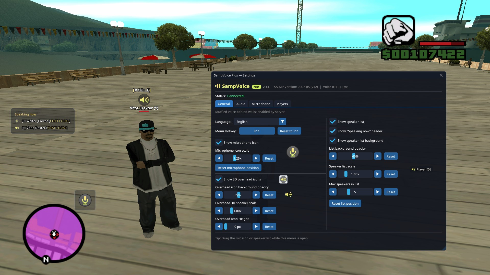

# SampVoice Plus

[](https://github.com/Walter-Correa/SampVoice-Plus/releases)
[](https://opensource.org/licenses/MPL-2.0)
[-orange.svg)](https://open.mp)

**SampVoice Plus** is a modern **C++20** voice chat system for **San Andreas Multiplayer (SA-MP)** and **open.mp** (32-bit x86 servers) paired with a **single-file Windows client (`sampvoice.asi`)** and an optional **15-language installer (`SampVoice-Plus-Setup.exe`)**:

* **SA-MP & open.mp Server Support:** Ships both a native open.mp component and a SA-MP `0.3.7-R2` / `R3` / `0.3.DL-R1` plugin for Windows and Linux (`x86`), with zero external relay processes.
* **One Client File Across Every PC Build:** Supports SA-MP `0.3.7-R1` through `0.3.7-R5-2-MP`, `0.3.DL-R1`, and open.mp launcher connections in a single `sampvoice.asi` without patching `samp.dll` or disturbing `PlayAudioStreamForPlayer`.
* **Backward Compatible with Scripts & Clients:** Runs existing **CyberMor 3.x** and **AmyrAhmady** Pawn scripts unchanged while accepting legacy PC `3.x`, Android `3.x`, and Plus clients side by side.
* **Full Audio & UI Feature Set:** 3D proximity chat, faction radios, phone calls, megaphones, 7 HUD stream icons, smooth parameter fades, all 9 DX8 audio filters, wall voice occlusion, per-player volume mixing, and an auto-sized 15-language `F11` menu.

> [!TIP]
> **Already using SampVoice?**
> 1. Swap your server plugin/component for SampVoice Plus. Existing compiled **CyberMor 3.x** and **AmyrAhmady** `.amx` scripts keep running without recompiling; update `sampvoice.inc` only if you recompile or want new Plus features.
> 2. Legacy PC `3.x` and Android `3.x` clients stay connected seamlessly alongside SampVoice Plus players.
> 3. **Two notes:** stream colors default to `0xRRGGBBAA` (set `sampvoice.legacy_color_format 1` if passing legacy `0xAARRGGBB`), and **CyberMor 4.x** scripts use a different API and need adaptation. See **[Migrating from Legacy SampVoice](docs/migrating-from-sampvoice.md)**.

---

<p align="center">
  
</p>

---

## Quick Start

* **Players:** Requires an existing PC **SA-MP** install (`samp.dll` + `bass.dll`) and an **ASI Loader**. Download `SampVoice-Plus-Client-Installer.zip` and run `SampVoice-Plus-Setup.exe` (bundles Ultimate ASI Loader automatically), or drop `Manual Install/sampvoice.asi` next to `gta_sa.exe` if you already have an ASI Loader (Ultimate ASI Loader `dinput8.dll`, Silent's ASI Loader, or CLEO). Press **`F11`** in-game for settings.
* **Server Owners:** Download `SampVoice-Plus-Server-Windows.zip` or `SampVoice-Plus-Server-Linux.zip`, place `components/sampvoice.*` (open.mp) or `plugins/sampvoice.*` (SA-MP), configure `sampvoice.port`, and load **`FS_SampVoicePlus_Demo`** (`/voice`).
* **Android Launcher Developers:** Download `SampVoice-Plus-Android-SDK.zip` (`include/svplus_mobile.h` and `libsvplus_mobile.so` for `arm64-v8a`, `armeabi-v7a`, and `x86_64`) — see the **[Android Launcher Integration Guide](docs/android-integration.md)**.
* **Scripters:** Include `<sampvoice>` after `<a_samp>` / `<open.mp>` — see **[Getting Started](docs/getting-started.md)** and the **[Complete API Reference](docs/api-reference.md)**.

---

## Comparison: SampVoice Implementations

| Feature | CyberMor 3.x | CyberMor 4.x | AmyrAhmady | SampVoice Plus |
| :--- | :--- | :--- | :--- | :--- |
| CyberMor 4.x clients | ❌ v11 only | ✅ v4 only | ❌ v11 only | ❌ v11 and v12 |
| Legacy v11 clients | ✅ Same protocol | ❌ Incompatible | ✅ Same protocol | ✅ Simultaneous |
| Server platforms | ⚠️ 0.3.7-R2 only | ⚠️ R2 and voice | ⚠️ open.mp only | ✅ open.mp, R2/R3, DL |
| PC client versions | ⚠️ R1, R3 only | ⚠️ R1, R3 only | ⚠️ R1, R3 only | ✅ R1–R5, DL, omp |
| Voice relay architecture | Integrated | Separate process | Integrated | Integrated |
| Client deployment | ⚠️ Extra DLL + files | ⚠️ Extra DLL + files | ⚠️ Manual DLL + files | ✅ Single file |
| Backup & restore setup | ❌ Overwrites files | ❌ Overwrites files | ❌ No installer | ✅ SHA-256 backup |
| Unpatched client & AC | ❌ Patches samp.dll | ❌ Patches samp.dll | ❌ Patches samp.dll | ✅ Zero patches |
| Pawn.RakNet coexistence | ❌ Permanent hook | ⚠️ Permanent hook | N/A (component) | ✅ One-shot hook |
| Fixed port & bind IP | ❌ Ephemeral port | ✅ Port and host | ⚠️ Fixed port only | ✅ Port and bind IP |
| UDP flood protection | ❌ None | ❌ None | ❌ None | ✅ Token bucket |
| GMX & filterscript safety | ❌ Raw pointers | ⚠️ Pool IDs only | ❌ Raw pointers | ✅ Generational cleanup |
| YSI y_hooks support | ❌ Broken | ⚠️ Tag issue | ⚠️ Tag issue | ✅ Compatible |
| Stream icons | ❌ Fixed icon | ✅ Custom PNGs | ❌ Fixed icon | ✅ 7 built-in |
| Listener & speaker control | ⚠️ Mic mute only | ✅ Full control | ⚠️ Mic mute only | ✅ Full control |
| Interior, VW & spectate | ❌ Distance only | ❌ Distance only | ⚠️ No spectate | ✅ Full filtering |
| Stuck speaker guard | ❌ Stale entries | ✅ Clears on stop | ❌ Inherited | ✅ 1 s hold / 5 s free |
| PlayAudioStream stereo | ❌ Mutates globals | ❌ Mutates globals | ❌ Mutates globals | ✅ Preserves BASS |
| In-game menu languages | 1 (Russian) | 5 languages | 1 (Russian) | ✅ 15 built-in |
| DX8 audio effects | ✅ 9 filters | ✅ 9 filters | ✅ 9 filters | ✅ 9 filters |
| Diagnostics & talk modes | ❌ PTT only | ⚠️ Lang, PTT only | ❌ PTT only | ✅ Full suite |
| Jitter, FEC & PLC | ⚠️ FEC only | ⚠️ Ring + PLC | ⚠️ FEC only | ✅ 35 ms + FEC/PLC |
| License | MIT | MIT | MIT | MPL-2.0 |

*For detailed technical backing on each row above, see **[Under the Hood — Comparison Notes](docs/under-the-hood.md#5-comparison-notes)**.*

---

## Supported Platforms

| Category | Supported Targets & Notes |
| :--- | :--- |
| **Server Binaries** | open.mp native component, SA-MP 0.3.7-R2 (R2-1, R2-2-1) & 0.3.7-R3 (Win/Linux x86), SA-MP 0.3.DL-R1 (Win/Linux x86). |
| **PC Clients** | SA-MP 0.3.7-R1, R2, R3/R3-1, R4, R4-2, R5-1 (R5-2-MP), 0.3.DL-R1 (DL-R1-2-MP), and open.mp launcher in one `.asi`. |
| **Operating Systems** | **Client:** Windows 7 SP1 or newer (Win32 x86 game). **Server:** Windows x86 or 32-bit x86 Linux (glibc 2.31+). |
| **Android Launchers** | ✅ Android launchers embedding SampVoice 3.x (`v11`) work with SampVoice Plus servers; launcher developers can embed Plus natively via `SampVoice-Plus-Android-SDK.zip` ([Integration Guide](docs/android-integration.md)). |
| **Legacy Compatibility** | CyberMor 3.x and AmyrAhmady (`v11`) clients interoperate seamlessly. **CyberMor 4.x clients cannot connect** and must use SampVoice Plus. |
| **Languages (15)** | Indonesian (`id`), German (`de`), English (`en`), Spanish (`es`), French (`fr`), Italian (`it`), Hungarian (`hu`), Polish (`pl`), Portuguese (`pt`), Romanian (`ro`), Vietnamese (`vi`), Turkish (`tr`), Bulgarian (`bg`), Russian (`ru`), Ukrainian (`uk`). |

---

## Documentation Hub

### Players
* **[📖 Getting Started (Client Install)](docs/getting-started.md#1-client-installation)** — guided installer, single-file manual install, and silent installer flags.
* **[🎧 Client & In-Game Settings (`F11`)](docs/client-and-ui.md)** — menu tabs, HUD controls, microphone loopback test, 15 languages, and `sampvoice.ini` reference.

### Server Owners & Scripters
* **[📖 Getting Started (Server Setup)](docs/getting-started.md#2-server-installation--configuration)** — binary placement, `server.cfg` / `config.json` options table, and loading the interactive demo FS.
* **[🔄 Migrating from Legacy SampVoice](docs/migrating-from-sampvoice.md)** — upgrading from CyberMor 3.x/4.x & AmyrAhmady, stream color format, 4.x native mapping, and staged Plus adoption.
* **[🔊 Audio Streams & DX8 Effects Guide](docs/audio-streams-and-effects.md)** — Global/SL/DL streams, standard vs Streamer objects, parameter sliding, DX8 presets, and 8 recipes.
* **[📚 Complete API Reference](docs/api-reference.md)** — exhaustive reference for all 108 natives, 8 callbacks, enums, and constants in [`sampvoice.inc`](sampvoice.inc).

### Troubleshooting & Advanced
* **[🛠️ Troubleshooting Guide](docs/troubleshooting.md)** — `F11` diagnostics, UDP firewall setup, mic recovery, Android `B` key handling, occlusion, and log warnings.
* **[📱 Android Launcher Integration Guide](docs/android-integration.md)** — step-by-step C integration (`svplus_mobile.h`), BASS ownership, threading contract, keys/HUD queries, and Android platform limits.
* **[⚙️ Under the Hood (Advanced)](docs/under-the-hood.md)** — wire protocol internals, anti-flood buckets, spatial formulas, PE detection table, comparison notes, and installer internals.
* **[🔍 Zero-Install Feasibility Analysis](docs/zero-install-analysis.md)** *(background reading)* — why vanilla SA-MP / open.mp requires a client `.asi`.

---

## Release Archives, Setup & Configuration

Each release provides **three dedicated archives** (`SampVoice-Plus-Setup.exe` lives inside `SampVoice-Plus-Client-Installer.zip` under `Installer/`):

```text
SampVoice-Plus-Client-Installer.zip   <-- For Windows players
  ├── Installer/
  │     ├── SampVoice-Plus-Setup.exe
  │     └── Instructions/ (15 languages)
  ├── Manual Install/
  │     ├── sampvoice.asi
  │     └── Instructions/ (15 languages)
  ├── LICENSE
  └── THIRD-PARTY-NOTICES.txt

SampVoice-Plus-Server-Windows.zip     <-- For Windows servers (open.mp / SA-MP x86; .amx also in repo filterscripts/)
  ├── components/sampvoice.dll
  ├── plugins/sampvoice.dll
  ├── include/sampvoice.inc
  ├── filterscripts/FS_SampVoicePlus_Demo.amx
  ├── filterscripts/FS_SampVoicePlus_Demo.pwn
  ├── LICENSE
  └── THIRD-PARTY-NOTICES.txt

SampVoice-Plus-Server-Linux.zip       <-- For Linux servers (open.mp / SA-MP x86; .amx also in repo filterscripts/)
  ├── components/sampvoice.so
  ├── plugins/sampvoice.so
  ├── include/sampvoice.inc
  ├── filterscripts/FS_SampVoicePlus_Demo.amx
  ├── filterscripts/FS_SampVoicePlus_Demo.pwn
  ├── LICENSE
  └── THIRD-PARTY-NOTICES.txt
```

> [!WARNING]
> Do **not** load both `components/sampvoice.*` and `plugins/sampvoice.*` at the same time on open.mp. SA-MP server mode supports **SA-MP `0.3.7-R2` (R2-1, R2-2-1), `0.3.7-R3`, and `0.3.DL-R1`** on Windows & Linux (`x86`). See **[Server Configuration Reference](docs/getting-started.md#server-configuration-reference)** for details on every option.

* **open.mp (`config.json`):** Place `sampvoice.dll` (or `sampvoice.so`) inside `components/`:
  ```json
  {
    "sampvoice": {
      "port": 7778,
      "bind": "0.0.0.0",
      "threads": 4,
      "updaterate": 30,
      "legacy_color_format": false,
      "voice_status": true,
      "nearby_list": true,
      "allow_toggle_mode": true,
      "voice_occlusion": true
    }
  }
  ```
* **SA-MP `0.3.7-R2 / R3 / 0.3.DL-R1` (`server.cfg`):** Place `sampvoice.dll` (or `sampvoice.so`) inside `plugins/`:
  ```cfg
  plugins sampvoice.dll    # (or sampvoice.so on Linux)

  # Optional tuning keys:
  sampvoice.port 7778      # 0 = automatic ephemeral port (logs a warning)
  sampvoice.bind 0.0.0.0
  sampvoice.threads 4
  sampvoice.updaterate 30
  sampvoice.legacy_color_format 0
  sampvoice.voice_status 1
  sampvoice.nearby_list 1
  sampvoice.allow_toggle_mode 1
  sampvoice.voice_occlusion 1
  ```

### Basic Pawn Example

```pawn
#include <open.mp> // Or <a_samp>
#include <sampvoice>

#define KEY_TALK (0x42) // 'B'

new SV_DLSTREAM:g_LocalStream[MAX_PLAYERS] = { SV_NULL, ... };

public OnPlayerConnect(playerid)
{
    if (SvGetVersion(playerid) != SV_NULL && SvHasMicro(playerid))
    {
        SvAddKey(playerid, KEY_TALK);
    }
    g_LocalStream[playerid] = SvCreateDLStreamAtPlayer(35.0, 24, playerid, 0xFFFFFFFF, "Local");
    return 1;
}

public OnPlayerDisconnect(playerid, reason)
{
    if (g_LocalStream[playerid] != SV_NULL)
    {
        SvDeleteStream(g_LocalStream[playerid]);
        g_LocalStream[playerid] = SV_NULL;
    }
    return 1;
}

public SV_VOID:OnPlayerActivationKeyPress(SV_UINT:playerid, SV_UINT:keyid)
{
    if (keyid == KEY_TALK && g_LocalStream[playerid] != SV_NULL)
    {
        SvAttachSpeakerToStream(g_LocalStream[playerid], playerid);
    }
}

public SV_VOID:OnPlayerActivationKeyRelease(SV_UINT:playerid, SV_UINT:keyid)
{
    if (keyid == KEY_TALK && g_LocalStream[playerid] != SV_NULL)
    {
        SvDetachSpeakerFromStream(g_LocalStream[playerid], playerid);
    }
}
```

> [!TIP]
> Want to test every feature live in-game? Add `FS_SampVoicePlus_Demo` to `filterscripts` (SA-MP) or `"filterscripts/FS_SampVoicePlus_Demo"` to `pawn.side_scripts` (open.mp) — pre-compiled **`filterscripts/FS_SampVoicePlus_Demo.amx`** is ready **both in the server zips and in the repository** alongside [`filterscripts/FS_SampVoicePlus_Demo.pwn`](filterscripts/FS_SampVoicePlus_Demo.pwn). Type **`/voice`** in-game.

---

## Complete API Reference (Summary) — 108 Natives & 8 Callbacks

Full signatures, enums, `Since` versions, and client requirements live in **[docs/api-reference.md](docs/api-reference.md)** and [`sampvoice.inc`](sampvoice.inc):

* **Core, Protocol & Statistics:** `SvDebug`, `SvInit`, `SvGetVersion`, `SvGetClientProtocol` (`11` legacy / `12` Plus), `SvGetPlusCapabilities` (`SV_CAP_ADAPTIVE_JITTER`, `SV_CAP_TELEMETRY`), `SvGetPlusClientVersion`, `SvIsPlayerVoiceReady`, `SvGetServerStats` (`SV_STAT_*`), `SvGetPlayerStats` (`SV_PSTAT_*`).
* **Microphone, Voice State, Keys, Key Bindings, Mutes & Listener Toggle:** `SvHasMicro`, `SvIsPlayerSpeaking`, `SvGetPlayerVoiceStatus`, `SvGetPlayerVoiceLatency`, `SvStartRecord`, `SvStopRecord`, `SvAddKey`, `SvHasKey`, `SvRemoveKey`, `SvRemoveAllKeys`, `SvBindKeyToStream`, `SvUnbindKeyFromStream`, `SvIsKeyBoundToStream`, `SvUnbindAllKeys`, `SvMutePlayerStatus`, `SvMutePlayerEnable(playerid, bool:releasekeys = false, time = 0)`, `SvMutePlayerDisable`, `SvMutePlayerRemaining`, `SvMutePlayerForListener`, `SvUnmutePlayerForListener`, `SvIsPlayerMutedForListener`, `SvEnableListener`, `SvDisableListener`, `SvCheckListener`.
* **Streams (`SV_STREAM_TYPE_GLOBAL`, `SV_STREAM_TYPE_SL_*`, `SV_STREAM_TYPE_DL_*`):** `SvCreateGStream`, `SvCreateSLStreamAt{Point,Vehicle,Player,Object}`, `SvCreateDLStreamAt{Point,Vehicle,Player,Object}`, `SvUpdateDistanceForLStream`, `SvUpdatePositionForLPStream`, `SvSetStreamPriority`, `SvGetStreamPriority`, `SvGetStreamPriorityDuck`, `SvStreamSetIcon`, `SvStreamSetName`, `SvStreamSetColor`, `SvStreamGetName`, `SvStreamGetColor`, `SvGetStreamType`, `SvGetStreamDistance`, `SvGetStreamPosition`, `SvGetStreamTarget`, `SvGetStreamMaxPlayers`, `SvStreamSetWorld`, `SvGetStreamWorld`, `SvGetStreamInterior`, `SvAttachListenerToStream(stream, playerid, Float:volume = 1.0)`, `SvStreamSetListenerVolume`, `SvStreamGetListenerVolume`, `SvGetStreamListenerCount`, `SvGetStreamListeners`, `SvHasListenerInStream`, `SvDetachListenerFromStream`, `SvDetachAllListenersFromStream`, `SvGetPlayerListenerStreams`, `SvAttachSpeakerToStream`, `SvGetStreamSpeakerCount`, `SvGetStreamSpeakers`, `SvHasSpeakerInStream`, `SvDetachSpeakerFromStream`, `SvDetachAllSpeakersFromStream`, `SvGetPlayerSpeakerStreams`, `SvDeleteStream`, `SvIsValidStream`.
* **Parameters (`SV_PARAMETER_*`):** `SvStreamParameter{Set,Reset,Has,Get,GetEx,SlideFromTo,SlideTo,Slide}`.
* **DX8 Audio Effects:** `SvEffect{Create,Update}{Chorus,Compressor,Distortion,Echo,Flanger,Gargle,I3dl2reverb,Parameq,Reverb}`, `SvEffectAttachStream`, `SvEffectDetachStream`, `SvEffectDelete`, `SvIsValidEffect`.
* **Callbacks (`8`):** `OnPlayerActivationKeyPress(playerid, keyid)`, `OnPlayerActivationKeyRelease(playerid, keyid)`, `OnPlayerMicroStateChange(playerid, bool:hasMicro)`, `OnPlayerVoiceMute(playerid, bool:releasekeys, time, bool:speaking)`, `OnPlayerVoiceUnmute(playerid, bool:expired)`, `OnPlayerVoiceReady(playerid)`, `OnPlayerVoiceStart(playerid)`, `OnPlayerVoiceStop(playerid)`.

---

## Building from Source

### Prerequisites
* **CMake** 3.20+
* **Visual Studio 2022** with Desktop C++ workload (Windows `Win32` x86)
* **Inno Setup 6** *(optional locally — if `ISCC.exe` is installed, `build_msvc.bat` builds `SampVoice-Plus-Setup.exe` too)*
* **GCC / G++ 10+** with multilib (`gcc-multilib g++-multilib`, Ninja recommended) for Linux 32-bit (`-m32`)
* Git submodules initialized (`git clone --recursive` or `git submodule update --init --recursive`)

### Compiling on Windows (1-Click Script)
```cmd
build_msvc.bat
```
*(Builds 32-bit `Win32` Release binaries in `build/`, optionally builds `dist/SampVoice-Plus-Setup.exe`, and produces `dist/sampvoice.asi`, `dist/SampVoice-Plus-Server-Windows.zip`, and `dist/SampVoice-Plus-Client-Installer.zip`.)*

### Compiling on Linux (32-bit x86)
```bash
cmake -B build-linux -G Ninja \
  -DCMAKE_BUILD_TYPE=Release \
  -DCMAKE_C_FLAGS="-m32" \
  -DCMAKE_CXX_FLAGS="-m32" \
  -DCMAKE_SHARED_LINKER_FLAGS="-m32" \
  -DSVPLUS_BUILD_SERVER=ON \
  -DSVPLUS_BUILD_CLIENT=OFF
cmake --build build-linux --parallel
```

---

## Version history

<details>
<summary>Show the version history</summary>

### 1.5.0 — 28/11/2026
- **For Server Owners & Scripters (`108` Natives & `8` Callbacks, Full `1.0.0`–`1.4.0` `.amx` Compatibility)**:
  - **Per-Channel Priority Ducking (`SvSetStreamPriority(..., priority_duck)`, `SvGetStreamPriorityDuck`, `SvCreate*Stream*`)**: Each channel now configures how loudly lower-priority channels remain for a listener (`0..100%`, default `50`, where `0` mutes and `100` disables ducking). Equal-priority active streams apply the lowest retained percentage among them, and live duck changes slide smoothly (`All clients`).
  - **Migration (`sampvoice.priority_duck` Removed)**: The global `sampvoice.priority_duck` server option has been removed (servers keeping it in `config.json` / `server.cfg` log one startup `[sv+:WRN]` and ignore it). Pass the desired percentage via `priority_duck` on `SvCreate*Stream*` / `SvSetStreamPriority`; existing `1.4.0` `.amx` scripts continue running unchanged at `50%`.
  - **Voice Connection & Diagnostic Logging**: Each voice connection now logs cleanly at `Info` level with client type, version, wire/protocol numbers, microphone status, and `mobile` flag without exposing the session key; priority ducking transitions and rate-limit drops (`PlusTelemetryPing` / `PlusVoiceLatency`, summarized per player every `5 s`) log at `Debug` level.
  - **Updated Demo Filterscript (`FS_SampVoicePlus_Demo`)**: Added 3 live-switchable megaphone distortion presets (**Light** default `-12.0` dB / `10%`, **Medium**, **Strong** via `SvEffectUpdateDistortion`), per-channel radio duck cycling (`0 / 20 / 50 / 80%`) preserving `Channel duck` across priority cycles, a `0%` personal listener volume option on radio channels to test ducking cleanly, and fixed hex formatting (`%x`/`%02x`) so open.mp displays capability masks and key-event logs properly.
- **For Players (`sampvoice.asi` & Mobile C SDK)**:
  - **Fixed Silent / Choppy Speech on Quick Re-Key (`< 5 s`)**: Fixed a long-standing client playback defect affecting all Plus clients (Windows PC and Android SDK, including pre-1.5.0 releases) where voice could go silent or stutter if a speaker stopped and started talking again within ~5 seconds; resuming after `> 250 ms` of silence now allocates a fresh BASS playback channel and decoder instead of reusing the paused BASS stream.
  - **Toggle Mode Unlatches Automatically on Interruptions**: In Toggle talk mode, opening chat, a dialog, or the pause menu, alt-tabbing, or backgrounding the app clears the active latch cleanly so you must press/tap again to resume transmitting.
  - **Clean Latency Reporting After Pause**: After an alt-tab or background pause, clients send only the latest latency report instead of flushing every report queued while suspended.
- **For Developers & Porting**:
  - **Mobile C SDK (`libsvplus_mobile.so` `1.5.0`)**: Added a `> 1 s` `svp_frame()` watchdog (automatically releases held or toggle-latched keys and pauses voice capture/playback until frames resume), `svp_status_t.audio_ready` (`V2`), `svp_get_key_states()` (atomic active hold/toggle-latch state alongside registered keys), `svp_get_tx_stats()` (`svp_tx_stats_t` pre/post-DSP dBFS levels, frame/encode-error counts, and watchdog counter), single-call `svp_build_join_rpc()` replacing any legacy `0xDEADBEEF` trailer in `RPC 25` cleanly, and automatic camera `up` derivation when hosts pass `(0, 0, 0)`.
  - **Updated Android Launcher Integration Guide**: Rewritten **[Android Launcher Integration Guide](docs/android-integration.md)** backed by real-device verification on ReSA `1.1.8` (`arm64-v8a`, `28/11/2026`), host-without-native-code patterns (LuaJIT FFI/script loaders, strict hook tuples, TBI pointer safety), and a 16-item integration test checklist.

### 1.4.0 — 27/11/2026
- **For Server Owners & Scripters (`107` Natives & `8` Callbacks, Full `1.0.0`–`1.3.0` `.amx` Compatibility)**:
  - **Key-to-Stream Bindings (`SvBindKeyToStream`, `SvUnbindKeyFromStream`, `SvIsKeyBoundToStream`, `SvUnbindAllKeys`)**: Automatically attach and detach speakers on registered key press/release (up to `32` `N:M` bindings per player, attaching immediately when a bound key is already held, preserving manual script speaker attachments, and firing `OnPlayerActivationKeyPress` / `Release` normally; compatible with Android's fixed `0x42` key).
  - **Channel Priority & Automatic Ducking (`SvSetStreamPriority`, `SvGetStreamPriority`, optional `priority = 0` on `SvCreate*Stream*`, `sampvoice.priority_duck`)**: Prioritized channels (`1` highest, `2` lower, `0` normal) smoothly duck lower-priority streams (`150 ms` down / `400 ms` restore after `1 s` silence) per listener using existing volume slides (`All clients`), ignoring same-priority and self-speech, without changing script-visible `SvStreamGetListenerVolume` / `SvStreamParameterGet`.
  - **Clean `v11` Forced Recreates Without Stuck Speaker Names**: When the `5 s` metadata recreate ceiling is reached under continuous speech for a legacy `v11` listener, voice forwarding pauses per listener for `1000 ms` before sending `DeleteStream` + `CreateStream` so the `v11` playback channel drains cleanly.
  - **Server & Player Voice Statistics (`SvGetServerStats`, `SvGetPlayerStats`, `SV_STAT_*`, `SV_PSTAT_*`)**: Lock-free, cache-line-aligned per-worker metrics covering uptime, player/stream/effect counts, total/1-second RX/TX packets & bytes, flood/invalid/queue drops, NAT port updates, pending `v11` deletes/recreates, `60 s` Tick µs avg/max, and per-player traffic/latency counters.
  - **Mobile Capability & Player Metric (`SV_CAP_MOBILE`, `SV_STAT_MOBILE_PLAYERS`)**: Servers detect Plus Android SDK clients (`SV_CAP_MOBILE`, index `29` in `SV_STAT_COUNT = 30`), shown in `FS_SampVoicePlus_Demo` under `"My voice status"` and `"Server stats"`.
  - **Updated Demo Filterscript (`FS_SampVoicePlus_Demo`)**: Added radio priority cycling (`0/1/2`), server-managed key bindings with active binding inspection, player stats inside `"My voice status"`, and an RCON-only `"Server stats"` dashboard.
- **For Developers & Porting**:
  - **Android C SDK (`SampVoice-Plus-Android-SDK.zip`)**: Stable C99/C++ API ([`svplus_mobile.h`](client/mobile/include/svplus_mobile.h) — see the **[Android Launcher Integration Guide](docs/android-integration.md)**) and prebuilt `libsvplus_mobile.so` (`arm64-v8a`, `armeabi-v7a`, `x86_64`) built cleanly on the portable client core (`svplus_client_core`); PC client behavior, performance, and single-file packaging remain unchanged.

### 1.3.0 — 26/11/2026
- **For Server Owners & Scripters (`99` Natives & `8` Callbacks, Full `1.0.0`–`1.2.0` `.amx` Compatibility)**:
  - **Runtime Stream Rename & Recolor (`SvStreamSetName`, `SvStreamSetColor`, `SvStreamGetName`, `SvStreamGetColor`)**: Change stream names and HUD tag colors at any time without recreating handles (`SvStreamGetColor` returns the script's raw color; setting the same value sends no traffic). **Plus `1.3.0+`** players see updated names and colors live immediately, while legacy `v11` and pre-`1.3.0` Plus players refresh cleanly during voice silence.
  - **Live DX8 Effect Updates (`SvEffectUpdate*`)**: Tune all 9 audio effects (`Chorus`, `Compressor`, `Distortion`, `Echo`, `Flanger`, `Gargle`, `I3dl2reverb`, `Parameq`, `Reverb`) live across attached streams without changing priority. **Plus `1.3.0+`** listeners update seamlessly in place; older clients refresh cleanly.
  - **Virtual World & Interior Filtering (`SvCreateDLStreamAtPoint` / `AtObject` & `SvStreamSetWorld`)**: Added optional trailing `worldid = -1, interiorid = -1` arguments (preserving `.amx` compatibility for existing calls) plus runtime `SvStreamSetWorld`, `SvGetStreamWorld`, and `SvGetStreamInterior`.
  - **Stream Inspection & Member Lists**: Added `SvGetStreamType` (`SV_STREAM_TYPE_GLOBAL`, `SV_STREAM_TYPE_SL_*`, `SV_STREAM_TYPE_DL_*`), `SvGetStreamDistance`, `SvGetStreamPosition`, `SvGetStreamTarget`, `SvGetStreamMaxPlayers`, `SvStreamParameterGetEx`, `SvGetStreamListeners`, `SvGetStreamSpeakers`, `SvGetPlayerListenerStreams`, and `SvGetPlayerSpeakerStreams`.
  - **Player Control Latency (`SvGetPlayerVoiceLatency`)**: Reports each **Plus `1.3.0+`** player's measured SampVoice control-channel round-trip latency in ms (same value shown in `F11`, or `-1` if unavailable/older client).
  - **Safer Input Validation, Return Codes & Script Reload Safety**: Rejected non-finite floats (`NaN`, `±Inf`), negative stream distances, negative `SV_PARAMETER_VOLUME`, and negative `SV_PARAMETER_FREQUENCY` cleanly before queuing updates, returning `1` when applied and `0` when rejected, and preventing crashes if one script unloads another during voice callbacks. Resetting or sliding the voice pitch (`SV_PARAMETER_FREQUENCY`) now works correctly on every client version, including older SampVoice Plus clients.
- **Interactive Demo Filterscript (`FS_SampVoicePlus_Demo`)**:
  - Replaced the single-file `Example.pwn` with a full zero-dependency interactive filterscript (`filterscripts/FS_SampVoicePlus_Demo.pwn`) and shipped it pre-compiled (`filterscripts/FS_SampVoicePlus_Demo.amx`) **ready both in the repository and inside both Windows and Linux server packages** for SA-MP and open.mp (`/voice` or `/voip`).
- **For Players (`sampvoice.asi`)**:
  - **Animated Header Logo While Listening**: Equalizer bars in the `F11` menu header now animate not only while speaking, but also while actively hearing an unblocked speaker with incoming audio audible (volume > 0 and neither deafened nor server listener-disabled).
  - **Stream Robustness & Idle Performance**: Safely ignores invalid negative/non-finite stream parameters/effects, restores `48000 Hz` playback properly on `0.0` frequency resets, and removes idle memory allocations from the background audio loop.
- **Compatibility & Reorganized Documentation**:
  - Legacy `1.0.0`–`1.2.0` `.amx` scripts, `CyberMor 3.x`, `AmyrAhmady`, Android `v11` clients, and Plus `1.0.0`–`1.2.0` clients all continue working seamlessly alongside `1.3.0`. Reorganized documentation by audience with an advanced **[Under the Hood](docs/under-the-hood.md)** reference.

### 1.2.0 — 26/11/2026
- **Server API Expansion (72 Natives & 8 Callbacks, Zero Wire Protocol Changes, Backward Compatible with `1.0.0`/`1.1.0` `.amx`)**:
  - **Voice Connection Readiness (`OnPlayerVoiceReady` & `SvIsPlayerVoiceReady`)**: Fires once per UDP-identified connection (`v11`, `v12`, and Android) right after `PluginInit` (+ Plus handshake packets) leaves `Tick()`, never on NAT port changes or GMX reloads (`SvIsPlayerVoiceReady` lets newly loaded scripts check state immediately).
  - **Speaking Activity (`OnPlayerVoiceStart` / `OnPlayerVoiceStop` & `SvIsPlayerSpeaking`)**: Fixed `50 ms` scan tracking accepted UDP voice frames for players attached as speaker on `>= 1` stream, firing `OnPlayerVoiceStop` after `> 1000 ms` of silence/mute (`speaking` state persists across GMX and clears silently on disconnect/`Stop()`).
  - **Plus Client Version & Status Query (`SvGetPlusClientVersion`, `SV_PLUS_VERSION_NUMBER`, `SvGetPlayerVoiceStatus`, `SV_VOICE_STATUS_*`)**: Exposes decoded `ConnectPlusExtension.clientBuild` as `MAJOR*10000 + MINOR*100 + PATCH` (`10000` for `1.0.0`, `10100` for `1.1.0`, `10200` for `1.2.0`, `0` for `v11`/Android) and lets scripts inspect voice status (`0` ok, `1` no mic, `2` cannot hear, `-1` invalid/disconnected) independently of `sampvoice.voice_status`.
  - **Generational Handle & Count Queries (`SvIsValidStream`, `SvIsValidEffect`, `SvGetStreamListenerCount`, `SvGetStreamSpeakerCount`)**: $O(1)$ validation rejecting `0` and deleted handles even after slot reuse, plus active listener/speaker counts per stream (`-1` if invalid).
  - **Per-Pair Server Mute (`SvMutePlayerForListener` / `SvUnmutePlayerForListener` / `SvIsPlayerMutedForListener`)**: Mutes `speakerid` exclusively for `listenerid` across `v11`, Android, and `v12` using a lock-free `1000 × 1024` atomic bit matrix (`~128 KB`) during voice forwarding without affecting stream memberships, voice-status icons, `Start`/`Stop`, or key callbacks; cleared on either player's disconnect and `Stop()`.
  - **Per-Listener Volume Multipliers (`SvAttachListenerToStream(..., Float:volume = 1.0)`, `SvStreamSetListenerVolume`, `SvStreamGetListenerVolume`)**: Multiplies `SV_PARAMETER_VOLUME` (or `1.0` default) per listener via existing `SetStreamParameter` (`19`) and `SlideStreamParameter` (`20`) packets, clamped to `[0.0, 4.0]` (negative/`NaN` rejected). Preserves exact `1.1.0` broadcast packets when all listeners use `1.0`, persists across range changes/blocks on dynamic streams (including when `SvAttachListenerToStream` sets a volume while out of range) until disconnect or `SvDeleteStream`, and treats 2-argument `.amx` calls identically to `1.0`. Remaining `SlideStreamParameter` durations in `BuildApplyPacket` are rounded up (`ceil`) so new listeners never lose a millisecond on creation.
  - **Packaging, CI & Documentation**: Expanded CI version verification (`SV_PLUS_VERSION_MAJOR/MINOR/PATCH/NUMBER/STRING`), `Example.pwn` client update check in `OnPlayerVoiceReady`, `linux-server-smoke.sh` (`SmokeAPI natives=72`), and API/architecture/troubleshooting guides.
- **Client UI, Audio Mix & Self-Test (`sampvoice.asi`)**:
  - **Per-Player Volume (`[player_volume]`, `0–200%`)**: Per-row volume button in `F11` → **Players** (amber highlight when `!= 100%`) opening a step-1 slider + **Reset** / **OK** (`Enter` or click; `Esc` closes only the topmost popup without exiting the menu) popup scoped per server (`<player> | <server> | <IP:port> | <vol>`; `100%` omits entry), multiplied via lock-free cached `masterVol * channelTypeVol * playerVol` clamped `[0.0, 4.0]`.
  - **Microphone Gain (`0–200%`) & Soft Limiter**: Replaced legacy `micro_volume` (`0–100%`, where `75%` was unity) with `micro_gain` (`0–200%`, default `100%` unity) plus a Reset button on **F11 → Microphone** and automatic `sampvoice.ini` migration (`lround(micro_volume * 100 / 75)`), engaging a `-3 dBFS` peak-envelope soft limiter above `100%` to prevent harsh clipping.
  - **Bursty / Mobile Voice Catch-Up & Timeout Resiliency**: Extended active-speaker hold & `OnPlayerVoiceStop` timeouts from `400 ms` to `1000 ms` (plus `5 s` BASS channel idle free) to prevent Android speaker flickering, fixed false `Camera basis mismatch` warnings on GTA RenderWare left-handed matrices, split `Metrics(60s)` `rxDrop` vs intentional `rxIgnored`, and added BASS push-queue catch-up (`+6%` speed above `300 ms`, tail flush above `800 ms`).
  - **Separate Proximity & Global Volumes**: Added `0–200%` sliders with Reset buttons under `F11` → **Audio** for proximity (`local_volume`) and global channels (`global_volume`).
  - **Client-Side Deafen & Hotkey**: Session-only toggle checkbox and optional `deafen_hotkey` (`0` = None, saved in `[sound]`) muting all decoded voice playback without altering server state or clearing the `"Speaking now"` list, displaying `speaker_deaf` beside the HUD mic icon (or in its place when hidden).
  - **Automatic Content-Driven F11 Menu Sizing (`MenuLayout`)**: Replaces fixed pixel window constants with four-pass content measurement across all tabs, dynamic warnings, and active language (`Wmin×Hmin` minimum constraint, `Wdef×Hdef` automatic size, manual drag-resize persistence via `menu_size_manual`, safety-net overflow recovery, and a footer **"Auto size"** reset button).
  - **Listen to Own Microphone**: Added `"Listen to my mic"` loopback self-test under `F11` → **Microphone** running `processMicDsp` through a dedicated Opus encoder/decoder + isolated BASS stream (`BASS_CONFIG_BUFFER=200` scoped) and auto-stopping cleanly on tab change, menu close, mic disable, or device change.
  - **Server-Enforced Push-to-Talk (`sampvoice.allow_toggle_mode`, default `true`)**: Extended `PlusServerOptions` (`108`) so servers can prohibit **Toggle** talk mode cleanly for `1.2.0+` clients — unlatching active toggles cleanly (`ReleaseKey` with `toggle_disallowed_by_server` unless physically held), showing PTT as the effective mode in `F11` → **Microphone** with Toggle grayed out + tooltip, and preserving the player's saved `talk_mode` in `sampvoice.ini` for other servers (`v11`, `1.0.0`, and `1.1.0` clients can be checked via `SvGetPlusClientVersion` if strict enforcement is desired).
  - **Wall / Obstacle Voice Occlusion (`sampvoice.voice_occlusion`, on by default)**: Server-enabled attenuation (on by default) for positional voice streams on `1.2.0+` clients using GTA SA building/object line-of-sight with shoot-through fences/scaffolding/cloth unmuffled (`<= 8` round-robin checks/frame, `100 ms` per-stream interval, 2-sample hysteresis with instant refresh after pauses `> 500 ms`, exempting the local player's own occupied vehicle and all global streams, ignoring the sound's own entity on object streams, and applying a `0.5 m` source margin on point/object streams) driving a `~1000 Hz` per-channel software low-pass DSP filter and `×0.5` (`−6 dB`) gain — starting new or resumed speech immediately in the right state while ramping mid-speech transitions smoothly over `~150 ms` *(servers upgrading from `1.1.0` get muffled voice behind walls for Plus `1.2.0` clients; set `sampvoice.voice_occlusion 0` to keep the `1.1.0` sound)*.
- **Installer Visual Overhaul (`SampVoice-Plus-Setup.exe`)**:
  - Custom multi-DPI vector wizard art (`wizard-large` & `wizard-small`), GTA San Andreas / SA-MP customized welcome/directory/finish messages in all 15 languages, formal Portuguese `pt` message overrides (`pra` → `para`), and automatic Windows light/dark theme adaptation (`WizardStyle=modern dynamic`).

### 1.1.0 — 26/11/2026
- **Key-Releasing & Timed Server Mutes (`SvMutePlayerEnable` & `SvMutePlayerRemaining`)**:
  - Extended `SvMutePlayerEnable(playerid, bool:releasekeys = false, time = 0)` while remaining 100% backward compatible with scripts compiled against 1-argument `1.0.0` includes (`1`, `2`, or `3` arguments accepted).
  - `releasekeys = true`: clears held activation key bits server-side, queues next-tick `OnPlayerActivationKeyRelease(playerid, keyid)` for each held key before `OnPlayerVoiceMute`, ignores delayed real `ReleaseKey` packets until a fresh `PressKey`, and sends `PlusMuteKeyLatch` (`107`) to `v12` Plus clients so held keys immediately stop transmitting/HUD display and stay latched until physically released and pressed again (even after unmute); legacy `v11` clients only receive standard `MuteEnable`/`MuteDisable` while still respecting server-side key release semantics.
  - `time > 0`: auto-unmutes after `time` ms (up to 24 h / `86400000` ms, clamped with `[WRN]`), replaces remaining duration on repeat `SvMutePlayerEnable` calls without firing a second mute callback, cancels cleanly on `SvMutePlayerDisable` or disconnect, and adds `SvMutePlayerRemaining(playerid)` (`-1` not muted, `0` indefinite, `> 0` ms remaining).
- **Mute Lifecycle Callbacks**:
  - Added `OnPlayerVoiceMute(playerid, bool:releasekeys, time, bool:speaking)` (next server tick, where `speaking` reports whether the player was attached as a speaker to any stream when `SvMutePlayerEnable` ran) and `OnPlayerVoiceUnmute(playerid, bool:expired)` (on the expiration tick for `expired = true`, or next tick after `SvMutePlayerDisable` for `expired = false`) delivered across all loaded AMX scripts (`amx_FindPublic` optional, never fired on disconnect or no-op calls).
- **Cross-Version Crash Log Preservation**:
  - Unclosed session logs left by other `sampvoice.asi` versions (upgrades or downgrades, including secondary `_log (2).txt` / `_log (pid N).txt` logs) are now archived as `[ERROR] sampvoice_plus_v<other-version>_log_<N>.txt` instead of being deleted on first launch.
  - Primary client sessions (slot 1) retain only the **10 most recent** `[ERROR]` logs across all versions (by last-write timestamp) on startup after archiving unclosed logs, pruning older entries automatically.
- **Local Speaker List Row Visibility (`v12+` Plus Servers)**:
  - On Plus (`v12+`) servers, the local player row in the HUD **"Speaking now"** list now only appears when at least one visible stream tag applies (positional streams always, global streams only when also attached as a listener), while still lighting the HUD microphone icon and transmitting audio to listeners normally; legacy `v11` servers retain the previous local row behavior.
- **Spatial 3D Camera Basis & Ped-Centered Distance Fixes**:
  - Fixed inverted left/right stereo panning in `SampBridge::getCameraBasis` by mapping GTA SA `CMatrix` `up` (`+0x10`, forward) and `at` (`+0x20`, world up) accurately (plus a one-time session `[WRN]` cross-check against `CMatrix::right`), and measured local spatial distance & direction from the local ped instead of the third-person camera when within 20 m (falling back to the camera when unavailable or > 20 m away in spectator/cutscene views) so nearby local voice stays at full `1.0` gain.
- **`SvInit` Bitrate Enforcement (`v12` Client & Server) & API Docs Alignment**:
  - `PluginInit` bitrate is now applied on the SampVoice Plus audio thread via `OPUS_SET_BITRATE` (logged at `[INF]`), resetting back to `24000` on disconnect or server change; both server `SvInit` and client enforce the `6000`–`128000` bps range (`0` selects `24000`, out-of-range values clamp with `[WRN]`), and `docs/api-reference.md` / `docs/audio-streams-and-effects.md` were aligned with actual parameter defaults and native behavior (`SvInit`, `SvGetVersion`, `SvHasMicro`).
- **Softer Local Distance Attenuation & 50% Stereo Pan (`v12` Client & `v11` Legacy Scaling)**:
  - Updated Plus local spatial attenuation to keep full volume up to `0.20 * distance` followed by a smooth `((max - d) / (max - min))^1.5` curve (`pan = 0.5 * dotRight * clamp(d / 3 m, 0, 1)`), sent `2x` local stream distance on the wire to legacy `v11` listeners only (keeping server real range unchanged) to approximate the softer falloff under BASS 3D, and unified `SvGetVersion` documentation across docs.
- **Voice Status Indicators & Players Tab (`v12` Server & Client)**:
  - Standardized all 15 UI languages on **Block / Blocked / Unblock** terminology inside the tab actions/sections and localized `[BLOCKED]` / `[BLOQUEADO]` HUD speaker tag in `#E5483C` (replacing `[BLACKLIST]`) while keeping the `sampvoice.ini` `[blacklist]` storage section and format 100% compatible.
  - Added server options `sampvoice.voice_status` (default `true`) and `sampvoice.nearby_list` (default `true`) delivered to Plus `v12` clients via `PlusServerOptions` (`108`), alongside chunked snapshot + delta replication packet `PlusPlayerVoiceState` (`109`: `0 = ok`, `1 = no micro`, `2 = cannot hear`; excludes server mutes and client blocks; never sent to `v11` clients).
  - Renamed the fourth F11 tab to **Players** (*Jogadores*), unifying the online player list (**All / Nearby** filter sorted closest-to-farthest without showing distances in meters), discrete localized voice-status marks, and per-player/global blocking in a single tab, and added overhead 3D `speaker_deaf` / `micro_missing` sprites above nearby players (`<= 30 m`) while transmitting and for `3 s` after key release, gated strictly on SA-MP nametag visibility across all 7 official SA-MP builds.
- **Release Packaging Changes**:
  - `SampVoice-Plus-Setup.exe` is now published exclusively inside `SampVoice-Plus-Client-Installer.zip` (`Installer/SampVoice-Plus-Setup.exe`) rather than as an additional standalone release asset.
  - Replaced the single English `INSTRUCTIONS.txt` files inside `SampVoice-Plus-Client-Installer.zip` with `Installer/Instructions/` and `Manual Install/Instructions/` folders containing all 15 client languages (`<code> - <Language>.txt`, UTF-8 with BOM and CRLF).
  - Removed the appended `sampvoice.asi SHA-256` footer from automated GitHub Release notes (`sampvoice.asi` continues logging its own SHA-256 on line 1 of every client session log).

### 1.0.0 — 24/11/2026
- Initial public release of **SampVoice Plus**, a complete C++20 ground-up re-architecture:
  - **Single-File Standalone Windows Client (`sampvoice.asi`) & Guided 15-Language Installer (`SampVoice-Plus-Setup.exe`)**: Bundles Opus 1.5.2, Dear ImGui 1.91.5, MinHook (`IDirect3DDevice9::Present`/`Reset`), `SetWindowLongA` `WndProc` subclassing, RakNet BitStream, and 17 PNG HUD sprites + font subsets via Windows `.rc` `RCDATA` with static `/MT` CRT and software spatial attenuation/panning + C++ per-speaker DSP directly on SA-MP's `bass.dll`. Installer enforces GTA-closed checks, repair/upgrade & downgrade protection, [Ultimate ASI Loader](https://github.com/ThirteenAG/Ultimate-ASI-Loader) (`dinput8.dll`, MIT), safe handling of legacy Inno uninstallers (`unins*.exe`) keeping `bass.dll`, and SHA-256 restore manifest on uninstall.
  - **Dedicated Audio Thread, Game-Thread RakClient Queue & Adaptive Prebuffer**: Offloads UDP socket lifecycle, capture scratch buffers, Opus encode/decode, lock-free immutable config snapshots, and software spatialized playback onto the dedicated audio thread while routing control packets safely through a game-thread MPMC queue and SEH-guarded GTA/SA-MP reads, with adaptive prebuffer (`N = 1..4` frames) + PLC + FEC.
  - **Universal SA-MP Client Bridge**: Paired PE header fingerprinting (`TimeDateStamp` + `AddressOfEntryPoint`) and verified memory offsets across **0.3.7-R1, R2, R3/R3-1, R4, R4-2, R5-1 (incl. R5-2-MP), 0.3.DL-R1 (incl. DL-R1-2-MP)**, and **open.mp** launcher connections, leaving `samp.dll` code unpatched.
  - **Rebuilt In-Game ImGui Settings Panel**: Configurable menu hotkey (**`F11`** default), **9-state F11 diagnostics + live voice RTT**, **15 built-in languages** (`id`, `de`, `en`, `es`, `fr`, `it`, `hu`, `pl`, `pt`, `ro`, `vi`, `tr`, `bg`, `ru`, `uk`) with real-time switching, **Push-to-Talk & Toggle talk modes**, **2s hot-plug microphone recovery & noise suppression DSP**, a two-part scoped player blacklist (`[blacklist]` in `sampvoice.ini` storing `<player> | <server name> | <IP:port> | server|all`), and debounced saves to `Documents\GTA San Andreas User Files\SAMP\sampvoice\sampvoice.ini`.
  - **Accurate 3D Head-Bone Overhead Anchoring & UTF-8 Colored Speaker List**: Positions overhead voice icons via `CPed::GetBonePosition(8)` and `SAMP\sa-mp.cfg` `fontsize` above the SA-MP nametag (with customizable `overhead_icon_height` slider `0–60 px`), converts ANSI/cp1252 channel, player, and server names safely to UTF-8, renders `(icon) [ID] Name [STREAM1] [STREAM2]` identically for remote players and the local speaker (via `PlusSpeakerStreams = 106` filtering global tags to joined streams, always keeping the mic icon locally) in SA-MP player + stream colors with 1 px black outlines (`sampvoice.legacy_color_format` on server converting `0xRRGGBBAA` -> `0xAARRGGBB` by default), keeps blacklisted speakers visible without decoding audio via red channel icons and `[BLACKLIST]` tag, centers HUD icons on `'H'`, and keeps header/option labels aligned.
  - **Strict Singleplayer Isolation & Async Client Session Logging**: Waits up to 10s for an official `samp.dll`/`samp.asi` PE signature (exiting with zero disk/hook/BASS activity in singleplayer), logs SHA-256 + categorized telemetry (`sampvoice_plus_v1.0.0_log.txt`) with automatic `[ERROR]` session archiving on crashes/errors, preserves third-party `GWL_WNDPROC` chains, and runs background read-only mod/hook diagnostics (`[INF:mods]`).
  - **Clean Game Exit Across All 7 Builds**: Coordinated shutdown hooks, RakClient teardown guards, and safe D3D9 fallback validation across SA-MP 0.3.7-R1 through R5 and 0.3.DL-R1.
  - **Real-Time Microphone Availability Callback (`v12`)**: Adds `PlusMicroState` control synchronization, reliable `conn.micro` handshake sync, and `OnPlayerMicroStateChange(playerid, bool:hasMicro)` Pawn callback.
  - **Persistent F11 Menu Geometry & Resolution-Independent HUD**: Automatically saves and restores F11 window position/size (`menu_x`/`y`/`w`/`h`), stores HUD positions as screen fractions (`0.0`–`1.0`) with independent scaling controls and one-click "Reset" buttons, toggleable `"Speaking now"` header (enabled by default), background opacity sliders, and `1`–`15` speaker list cap.
  - **Custom Stream Icons, Global Listener Control & Android Notes**: Adds `SvStreamSetIcon` (7 original SVG/PNG icons: `speaker`, `radio`, `phone`, `megaphone`, `police`, `admin`, `global`) and `SvEnableListener` / `SvDisableListener` / `SvCheckListener` for server-side listener gating, and documents Android 3.x launcher `0x42` (`B`) key behavior.
  - **High-Performance 32-Bit Server Core**: **open.mp component** and **SA-MP `0.3.7-R2` (R2-1, R2-2-1), `0.3.7-R3`, and `0.3.DL-R1` server plugin** for Windows & Linux (`x86`), backed by `WSAPoll` / `poll` + `recvmmsg`, lock-free queues, copy-on-write listener snapshots, `PacketPool`, CRC32C verification, `O(1)` spatial hash grid with **interior, virtual world, and spectate filtering**, **per-player UDP voice (`30 pkt/s`, burst `10`) & control packet rate limiters with key-edge deduplication and guaranteed `ReleaseKey`**, **strict fixed-port (`SO_EXCLUSIVEADDRUSE`) / `sampvoice.bind` config validation & legacy aliases (`sampvoice_port`, `sv_voice_port`, `sampvoice_bind`, `sampvoice_threads`, `sampvoice.update_rate`, `sampvoice_updaterate`)**, **`Pawn.RakNet` & `YSF` coexistence** (one-shot `GetRakServerInterface` hook + `~RakServer` vtable restoration guard), **`y_hooks`-compatible `sampvoice.inc`**, **single-line startup logging (`SvDebug(true)` on-demand `Effective config`)**, automatic per-AMX GMX cleanup, and same-ID fast reconnect cleanup.
  - **Generational 32-Bit Handles & `v11`/`v12` Interoperability**: Safe 32-bit opaque handle pool (`HandlePool`) with full simultaneous support for legacy `v11` (`CyberMor` v3.x / `AmyrAhmady` / Android launchers) and Plus `v12` clients.
  - **Release Archives**: Split cleanly into **`SampVoice-Plus-Client-Installer.zip`** (`Installer/SampVoice-Plus-Setup.exe`, `Installer/INSTRUCTIONS.txt`, `Manual Install/sampvoice.asi`, `Manual Install/INSTRUCTIONS.txt`, `LICENSE`, `THIRD-PARTY-NOTICES.txt`), **`SampVoice-Plus-Server-Windows.zip`** (`plugins/sampvoice.dll`, `components/sampvoice.dll`, `include/sampvoice.inc`, `Example.pwn`, `LICENSE`, `THIRD-PARTY-NOTICES.txt`), **`SampVoice-Plus-Server-Linux.zip`** (`plugins/sampvoice.so`, `components/sampvoice.so`, `include/sampvoice.inc`, `Example.pwn`, `LICENSE`, `THIRD-PARTY-NOTICES.txt`), and standalone **`SampVoice-Plus-Setup.exe`**.

</details>

---

## Author & Credits

* [@Walter-Correa](https://github.com/Walter-Correa) - Architecture and implementation of **SampVoice Plus**, with the assistance of **Artificial Intelligence**.
* [@AmyrAhmady](https://github.com/AmyrAhmady) - Author of the open.mp adaptation of `sampvoice`.
* [@CyberMor](https://github.com/CyberMor) - Original creator and architect of `sampvoice`.
* **Third-Party Libraries & Tools:** [open.mp SDK](https://github.com/openmultiplayer/open.mp-sdk), [open.mp Network](https://github.com/openmultiplayer/open.mp-network), [RakHook](https://github.com/imring/RakHook), [Opus](https://github.com/xiph/opus), [Dear ImGui](https://github.com/ocornut/imgui), [Google Noto Sans](https://github.com/notofonts/latin-greek-cyrillic) (OFL-1.1), [MinHook](https://github.com/TsudaKageyu/minhook), [stb_image](https://github.com/nothings/stb), [Ultimate ASI Loader](https://github.com/ThirteenAG/Ultimate-ASI-Loader) (MIT), and BASS.

---

## License

This project is licensed under the **Mozilla Public License 2.0 (MPL-2.0)** - see the [LICENSE](LICENSE) file for details.
